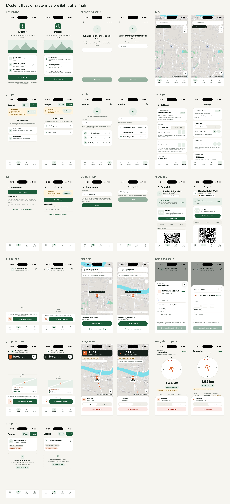

<p align="center"></p>

# Muster

Group navigation for hikes and outdoor events that works with no internet and no cell signal.

Muster gives a group offline maps, GPS, meeting points and live positions of everyone nearby. Phones talk to each other directly over a Bluetooth mesh, using the [Offline Protocol SDK](https://github.com/Offline-Protocol/offline-protocol-sdk). There is no backend and no account.



## What it does

- **Offline maps.** Download a region, or cut a custom area on the map, and use it with no connection. Map data is © OpenStreetMap contributors.
- **Groups.** A leader creates a group and invites people face to face with a QR code. Only the leader publishes meeting points and updates. Followers receive them.
- **Live positions.** Members within mesh range see each other on the map. Messages hop across phones, so you don't have to be next to someone.
- **Meeting points and navigation.** Navigate to a meeting point or a saved place with a compass and distance. Where a downloaded map has paths, Muster finds a walking route.
- **Private by design.** No telemetry. Location is used only while the app is open. Coordinates are never written to the logs.

## How the mesh works

Each phone runs the Offline Protocol SDK over Bluetooth Low Energy. Every member publishes one small document with their latest position. Nearby phones relay it, so it spreads through the group without internet. The app treats replicated state as the truth and messages only as hints, so a member who was out of range catches up when they come back. Details are in [docs/MESH_PROTOCOL.md](docs/MESH_PROTOCOL.md) and [docs/SDK_INTEGRATION.md](docs/SDK_INTEGRATION.md).

## Getting started

You need Node 20 or later. For iOS: macOS, Xcode and CocoaPods (iOS 15.1 or later). For Android: Android Studio (Android 7.0, API 24, or later). See the [React Native environment setup](https://reactnative.dev/docs/set-up-your-environment).

```bash
git clone https://github.com/aditipolkam/muster.git
cd muster
npm install --legacy-peer-deps
cd ios && pod install && cd ..
npm run ios          # or: npm run android
```

> **SDK note.** The app pins the published `@offline-protocol/mesh-sdk@0.32.0` (AGPL-3.0). To build against a local SDK checkout at `../offline-protocol-sdk` instead, run `scripts/sdk-source.sh local`, and `scripts/sdk-source.sh npm <version>` to go back.

### Mesh features need real phones

The iOS Simulator and the Android emulator have no Bluetooth, so the mesh can't run there. To try groups and live positions, install the app on two or more physical phones. Maps, navigation and the rest of the UI work in a simulator.

### Maps

- **Debug builds** stream the public [Protomaps](https://protomaps.com) planet file to show a map while no region is downloaded (labelled "Online map · not saved"). They also read a region catalog from your computer at `http://localhost:8787`.
- **Release builds** have no map source built in. Muster doesn't host maps, so host your own region catalog and set its URL in Settings.

To build and serve regions locally:

```bash
node tools/region-builder/build.mjs --source https://build.protomaps.com/<YYYYMMDD>.pmtiles --base-url http://localhost:8787
node tools/region-builder/serve.mjs
```

`build.mjs` needs the [`pmtiles`](https://github.com/protomaps/go-pmtiles) CLI. Don't use the public OpenStreetMap tile servers for offline downloads; their policy forbids it.

## Project structure

```
src/
  app/          navigation and app shell
  domain/       pure logic: geo, routing, groups, merge rules (no React Native, no SDK)
  mesh/         the only place that talks to the Offline Protocol SDK (MeshPort)
  data/         SQLite storage and projections
  features/     screens: map, groups, navigate, maps-manager, settings, profile, ...
  ui/           design tokens and shared components
tools/region-builder/   build and serve offline map regions
docs/                   architecture, protocol, data models, ADRs
```

## Development

```bash
npm test            # jest
npm run typecheck   # tsc --noEmit
npm run lint        # eslint, including import-boundary rules
```

- `src/domain` holds pure logic (geo, merge, sampling) and imports nothing from React Native or the SDK.
- Only `src/mesh/sdk.ts` imports the SDK. Everything else goes through `MeshPort`.
- Network calls are allowed only in `src/features/maps-manager`, and only when the user asks.
- UI primitives and design tokens are in `src/ui`. See [docs/DESIGN_SYSTEM.md](docs/DESIGN_SYSTEM.md).

Architecture and decisions: [docs/ARCHITECTURE.md](docs/ARCHITECTURE.md), [docs/MAP_ARCHITECTURE.md](docs/MAP_ARCHITECTURE.md), [docs/DATA_MODELS.md](docs/DATA_MODELS.md) and the ADRs in [docs/adr](docs/adr). [docs/PROGRESS.md](docs/PROGRESS.md) is the working log of what is built and what has been tested on devices.

## Forking

If you ship your own build, change these so your app doesn't share a mesh network or store IDs with Muster:

- `meshAppId` in `src/shared/config.ts` (`app.muster`)
- The bundle ID `app.muster` in the Xcode project and in `android/app/build.gradle`
- The Apple `DEVELOPMENT_TEAM` in the Xcode project
- `userAgent` in `src/shared/config.ts` (sent to the place-search service)

## Limitations

- Location updates only while the app is in the foreground.
- iOS has been tested more than Android.
- SDK `0.32.0` lacks a session-probe back-off fix that is in the SDK's unreleased code, so mesh sessions can retry more often than needed until the next SDK release.
- Group activities (checkpoints, phases) are built but switched off (`src/shared/features.ts`).
- Muster isn't published to the app stores and doesn't host maps. Build it from source; release builds need your own map catalog (see Maps).

## Contributing

See [CONTRIBUTING.md](CONTRIBUTING.md), the [code of conduct](CODE_OF_CONDUCT.md) and the [security policy](SECURITY.md). Changes are listed in [CHANGELOG.md](CHANGELOG.md). [docs/README.md](docs/README.md) indexes the docs.

## Licence

Muster is licensed under the [GNU Affero General Public License v3.0 only](LICENSE), because the Offline Protocol SDK it uses is AGPL-3.0 (the SDK is also available under a commercial licence). Muster is not distributed through app stores. Third-party notices, including map data © OpenStreetMap contributors ([ODbL](https://www.openstreetmap.org/copyright)), are in [NOTICE](NOTICE).
