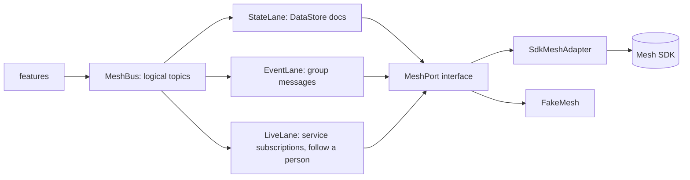
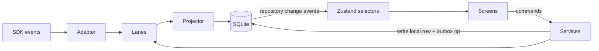
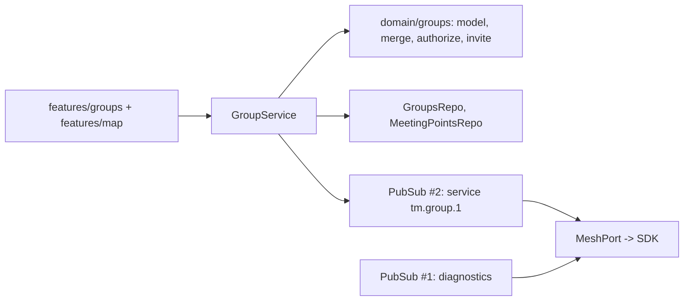

# TrailMesh Architecture

TrailMesh is an offline-first group navigation app: maps, GPS, meeting points and live group positions that keep working with no cellular or internet, using the Offline Protocol mesh SDK over Bluetooth (and Wi-Fi Direct on Android).

Companion docs: `SDK_INTEGRATION.md` (what the SDK does), `MAP_ARCHITECTURE.md`, `MESH_PROTOCOL.md`, `DATA_MODELS.md`, `DEVELOPMENT_PLAN.md`.

## 1. Principles

1. **Offline is the default state.** No code path on the core flows may require connectivity. Connectivity is used only for optional map downloads.
2. **Local-first.** The device SQLite database is the source of truth for the UI. The mesh replicates; it never drives the UI directly.
3. **State is canonical, events are hints.** Anything a reconnecting member must learn is replicated state; messages only notify.
4. **Single writer per key.** Each member writes only to its own replicated document, so there are no write conflicts to resolve.
5. **Ports and adapters.** SDK, GPS, DB, file transfer and map are behind interfaces; fakes make the logic testable without radios.
6. **Honest about guarantees.** The UI shows "last heard X ago", never a silent stale position.
7. **Privacy by default.** Location sharing is opt-in per group, time-boxed, and revocable.

## 2. Technology choices

| Area | Choice | Why | Alternative |
|---|---|---|---|
| Framework | **React Native 0.82.x, bare (CLI), TypeScript strict, New Architecture, Hermes** | Matches the version the SDK examples run (0.82.1); SDK needs manual `Info.plist`/manifest/foreground-service control and `index.js` task registration | Expo prebuild (CNG): viable, more churn around native config |
| Native modules from Expo | `expo-location`, `expo-battery`, `expo-file-system`, `expo-keep-awake` via `install-expo-modules` | Maintained, config plugins, no GMS dependency | Community libs (verify maintenance) |
| Map | `@maplibre/maplibre-react-native` v11 | See `MAP_ARCHITECTURE.md` | none |
| Navigation | React Navigation (native stack + bottom tabs) | De-facto standard | Expo Router (tied to Expo) |
| State | **Zustand** for UI/session state; SQLite is the data store; typed repository events for invalidation | Small, no boilerplate; avoids a second cache layer | Redux Toolkit |
| SQLite | `@op-engineering/op-sqlite` behind `DbPort` | JSI, synchronous-capable, New Arch ready; swap to `expo-sqlite` possible | `expo-sqlite` (lower friction). Final pick after a benchmark in Phase 1 (S1-3) |
| Validation | `zod` for every envelope and document record | Wire data is untrusted | valibot |
| IDs | ULID (sortable, no coordination) | Offline id generation | UUIDv7 |
| Geo math | `@turf/*` micro-packages + own `geo/` pure functions | Tested, tree-shakeable | own only |
| XML | `fast-xml-parser` | No DOM on Hermes | |
| Testing | Jest + React Native Testing Library; Maestro or Detox for E2E; fake mesh | | |
| Lint/format | ESLint (incl. import-boundary rules), Prettier, `tsc --noEmit` | | |

Library maintenance status (versions, last release) is re-verified at adoption time in Phase 1; only MapLibre RN v11.5.1 was verified for this document.

## 3. Project structure

```
trailmesh/
  CLAUDE.md
  docs/
  scripts/                 sdk-source.sh, build-region.sh (pmtiles extract), check-boundaries
  tools/region-builder/    maintainer-only tile extraction + catalog generation
  src/
    app/                   entry, providers, navigation, theming
    features/
      map/                 MapScreen, layers, StyleBuilder, TileSourceStrategy
      maps-manager/        MapPackManager UI + download state machine
      location/            LocationPort + expo adapter, sampling policy, permissions
      groups/              create/join/members, invite flow
      meeting-points/
      live/                member positions, status, arrival
      navigation/          bearing/distance, trail follow
      trails/              GPX import, track store
      settings/            privacy, battery, diagnostics
    domain/                pure TS: models, zod schemas, geo math, reducers, merge rules (no RN imports)
    data/                  DbPort, migrations, repositories, projections
    mesh/                  MeshPort, SdkMeshAdapter (only importer of the SDK), FakeMesh,
                           MeshBus, lanes (state/event/live), codec, SyncEngine
    platform/              file system, battery, keep-awake, permissions adapters
    shared/                logging, errors, clock, ids, result type
  __tests__/ e2e/
```

Dependency rule (enforced by ESLint `import/no-restricted-paths`):

```mermaid
flowchart TD
  features --> domain
  features --> data
  features --> mesh
  features --> platform
  mesh --> domain
  data --> domain
  platform --> domain
  mesh -.->|only src/mesh/sdk.ts| SDK[(@offline-protocol/mesh-sdk)]
  domain -.->|imports nothing else| X[ ]
```

`domain/` imports nothing from RN, SDK or features. `features/*` never import each other (they talk through repositories and services).

## 4. Mesh communication abstraction



`MeshPort` (TypeScript, sketch; the final shape is a Phase 2 deliverable):

```ts
interface MeshPort {
  start(cfg: MeshConfig): Promise<void>;           // listeners registered before SDK start
  stop(): Promise<void>;
  localAddress(): Promise<string | null>;
  status$: Observable<MeshStatus>;                 // running | stopped | stoppedByUser, transports, peerCount
  peers$: Observable<PeerEvent>;                   // discovered | lost, address, rssi, transport
  // groups
  createGroup(name: string): Promise<GroupInfo>;
  invite(groupId: string, address: string): Promise<void>;
  leaveGroup(groupId: string): Promise<void>;
  groupInfo(groupId: string): Promise<GroupInfo | null>;
  groupEvents$: Observable<GroupEvent>;
  // lanes
  docs: ReplicatedDocs;                            // setInterest, mapSet, mapGet, docJson, flush, changes$
  events: GroupEvents;                             // send(groupId, envelope), received$
  directRequest(address, payload): Promise<MessageId>;
  setBattery(level: number, charging: boolean): Promise<void>;
}
```

**MeshBus** is TrailMesh's pub/sub. Because the SDK has no group-scoped topics (`SDK_INTEGRATION.md` §4), the bus maps logical topics to lanes. Callers `publish(topic, payload)` and `subscribe(topic, handler)` and do not know the lane.

Topic naming and lane mapping are specified in `MESH_PROTOCOL.md`.

Rules:
- Every inbound SDK event is persisted (or projected) **in the handler**, keyed by id, before anything slower runs (SDK requirement, `react-native-integration.md` §6.4).
- Handlers are idempotent; dedupe by envelope id.
- The adapter owns SDK lifecycle (listener-before-start, setInterest-before-start, battery feed, foreground reconcile, never reuse destroyed instance).

## 5. State management



- **Commands** (user intent) go through services, which write SQLite first (with a pending outbox op), then ask the lane to publish.
- **Projectors** turn replicated docs/events into SQLite rows (merge rules from `DATA_MODELS.md`).
- Zustand holds only ephemeral UI state (selected marker, camera mode, sheet state) and cached derived values (current fix, mesh status). Persistent data is read from repositories through hooks (`useMeetingPoints(groupId)`) subscribed to table-level change events.

## 6. Local database

SQLite, WAL mode, `PRAGMA user_version` migrations (forward only, each migration idempotent and tested from every previous version). Full schema in `DATA_MODELS.md`.

- Single write queue (serialised) to avoid `SQLITE_BUSY` between projectors and UI commands.
- Every replicated row carries its provenance (`author`, `rev`, `source_doc`, `received_at`).
- An `outbox_ops` table holds not-yet-flushed local changes so they survive a crash between "saved locally" and "flushed to the mesh". On start the SyncEngine replays them (idempotent: same key/value, `rev` unchanged).
- Backup/restore: the DB is excluded from cloud backup (contains location history) unless the user opts in.

## 7. Group identity and membership

- **Device identity** = SDK `off1…` address (`localAddress()`), stable per `appId`+`profile`. The user's display name and colour are app-level and live in the member's own replicated doc.
- **Group identity** = MLS `groupId` returned by `meshCreateGroup`. TrailMesh adds metadata in a `group` doc (name, created, `minAppVersion`, invite token hash, sharing defaults).
- **Membership truth** = the MLS roster (`meshGetGroupInfo(...).memberIds`), never a TrailMesh list. Member docs from non-members are ignored.
- **Roles:** creator is admin; admins can invite/remove/rename; promote co-admins (`meshSetMemberRole`) so trips survive the creator leaving. The last admin cannot leave (SDK rule).
- **Joining in person** (offline): admin shows a group QR (`trailmesh://join?v=1&a=<adminAddr>&t=<token>&n=<name>`); the joiner scans it and sends `sendConnectionRequest` to the admin with the join payload as `initialMessage`; the admin's app validates the token, shows "Alex wants to join", and on approve calls `meshInviteToGroup`. Alternative: joiner shows their address QR and the admin scans it and invites directly. Verifying the address by QR defends against a nearby device impersonating a name. The online invite-link mechanism is not used (depends on relay).
- **Trust model:** group members are trusted friends. SDK membership commits are not enforced on receive and DataStore docs have no authorship check; TrailMesh does not claim to defend against a malicious member. (`SDK_INTEGRATION.md` G3, G4.)

## 8. Synchronisation and recovery

Layers, from most authoritative to least:

1. **Replicated documents** (SDK anti-entropy, triggered by session confirmation, peer rediscovery, start-up, group join, local flush, and 3-second quiet "settle offer") - the reconnect path.
2. **Group event messages** (at-least-once, <= 7-day outbox) - immediacy only.
3. **Local SQLite** - what the user sees.

Reconnect algorithm (`SyncEngine.onPeerBack`): wait for `data_changed` bursts to settle, project, compute "what changed since I was last here" from `received_at` vs `last_seen_at`, surface a catch-up summary (new meeting point, X arrived, Y last seen 2 h ago). No custom sync protocol is built in v1; the app adds only **projection, ordering and presentation**.

Sync health is observable: per member `last_doc_change_at`, per group `converged?` approximation (all member docs seen within N min), and SDK `getPendingAckCount()` / `getRetryQueueSize()`.

## 9. Location sharing and privacy

Settings are **per group**:

| Control | Values |
|---|---|
| Share my location | Off / On / **Until** (1h, 4h, end of day, custom) |
| Precision | Exact / ~100 m / ~1 km (rounded before publish) |
| Interval | Auto (adaptive) / Battery saver / Frequent |
| Pause on arrival | on/off |
| Share in background | off by default (Phase 6) |

Mechanics:
- Rounding and filtering happen **before** the record leaves the device; the SQLite copy of my own track is full precision and local.
- Off/expiry -> `unregisterService` for that group's live service (ends every follower's subscription, the SDK's cryptographic-free but immediate kill switch), write `{sharing:false, pos:null}` to my member doc for late joiners, stop the publish loop, clear in-memory fixes. The UI shows others as "not sharing". Per-follower removal uses `endServiceSubscription`. Note this is a promise, not cryptography: followers keep the 1:1 session (ADR 0035; ADR 0036 would make it cryptographic).
- **Honest limitation:** replicated documents keep change history until compaction, and peers may have stored earlier positions. Disabling stops future sharing; it does not retract the past. The UI says so in the sharing sheet. (`SDK_INTEGRATION.md` G7.)
- Leaving a group: stop publishing, delete that group's member positions locally (configurable), `meshLeaveGroup`.
- Relay duty: a "Help relay for others" toggle maps to `relayPriority` (`never | auto | always`) with a battery floor.
- No analytics, no telemetry, no backend. `enableTelemetry` is never called.
- Retention: other members' last-known positions purged after N days (default 3); own breadcrumbs after N days (default 7). User-adjustable, "Delete all data" in settings (`wipePersistedState` + DB wipe).

## 10. Battery and performance

- **GPS sampling policy** (`SamplingPolicy`, pure and unit-tested): inputs speed, accuracy, last published fix, battery level, sharing interval, app state. Rules: publish when moved > max(25 m, accuracy) or > 60 s elapsed while moving; stationary heartbeat every 5 min; battery < 20% -> double intervals; < 10% -> only on significant move.
- **Coalescing:** the Live lane keeps at most one pending update per key.
- **SDK feed:** `setBatteryState` on start and each change.
- **Flush throttle:** DataStore flush at most ~2/s per doc (SDK guidance), batched with the sampling policy.
- **Bluetooth** is managed by the SDK; app-side we avoid extra wake-ups (no polling timers faster than 1 Hz for non-map work).
- **UI:** map updates imperative; list screens virtualised; heavy work (GPX parse, simplification) off the JS thread where possible (chunked or worker-like scheduling).
- **Budgets (to be verified on devices, Phase 6):** mesh + GPS foreground sharing <= ~6%/h battery on a mid-range phone [ASSUMPTION A-16]; cold start to interactive map < 3 s with a region installed.

## 11. Error handling and logging

- `Result<T, AppError>` at service boundaries; `AppError` has a stable `code`, `retryable`, `userMessage`. No bare `throw` across layers.
- Mesh errors are normalised in the adapter (SDK errors, `diagnostic` events including `native_event_gap`, `mesh_stopped_by_user`).
- Logging: levelled logger with ring buffer persisted to a rotating file (2 MB x 3), **never logging coordinates at info level** (positions are redacted unless a debug flag is on); export bundle for field testing via share sheet (no upload).
- A Diagnostics screen shows transports, peer table, topology, retry queue, event-gap count, last sync per member, storage usage, map regions.
- User-visible failure language: "Couldn't reach Sam (last heard 12 min ago). Will retry when nearby."

## 12. Behaviour in specific situations

| Situation | Behaviour |
|---|---|
| **A device disconnects** | `neighbor_lost` -> peer shown "out of range"; its last-known position stays with age; pending outbound frames stay in the SDK outbox and retry; no UI error. Presence derived from `lastHeardAt`, not from transport events alone |
| **A new peer joins an existing group** | Admin invites (QR flow). On Welcome, the joiner's DataStore starts anti-entropy for the group space and pulls all member docs; projectors build local state. Joiner sees meeting points and last-known positions; it does **not** see past event messages (MLS). A `minAppVersion` check refuses old builds |
| **A member reconnects after hours** | Peer rediscovery triggers document exchange; they receive current docs, not a replay; catch-up summary is generated locally. Event messages queued by senders (<= 7 days, only while the sender's outbox lives) may also arrive late and are deduped by id and ordered by `ts` |
| **Two devices publish simultaneously** | Different members write different docs, so no conflict. Same-point concurrent edits live in each editor's own doc; readers pick highest `(rev, authorAddr)` deterministically on every device. Live positions are per member so never contend |
| **GPS becomes unavailable** | Fix age grows; UI shows "GPS lost" with last fix time; own marker greys; sharing publishes `gps:false` once then pauses position updates (no fake positions); navigation shows last-known-based bearing flagged "stale"; auto-resumes on next fix |
| **Offline map data missing** | Base world map + overlays render; banner offers download/import; navigation and markers unaffected |
| **A meeting point is updated multiple times** | Each edit increments `rev = max(seen)+1` in the editor's doc; all devices project the same winner; history of edits kept (bounded) for an "edited by" label; edits arriving out of order never regress state |
| **A user disables location sharing** | See §9. Immediate local effect; peers see "not sharing" after the next sync; optional auto-resume prompt |
| **App moves to background** | v1: foreground-first. On `background`, flush docs, persist state, keep SDK running if the platform allows (iOS BT modes, Android foreground service); location sharing pauses unless the user enabled background sharing; a persistent state banner on return: "Sharing paused while in background". On `active`: reconcile SDK `getState()`, restart if needed, re-apply interest, kick sync |

## 13. Architecture decisions (summary)

| ID | Decision | Trade-off |
|---|---|---|
| AD-1 | Bare RN 0.82, New Arch | More native config than Expo, exact SDK parity |
| AD-2 | MapLibre v11 + PMTiles files | Spike-gated; no backend, single-file regions |
| AD-3 | Replicated docs as canonical shared state; messages as hints | Fewer moving parts, relies on DataStore (shipped, but BLE slow) |
| AD-4 | Single-writer member documents | No conflict logic needed; no authorship enforcement by SDK |
| AD-5 | **Live state = per-person service subscriptions** (each member publishes; others subscribe to that member). Member-doc `pos` key is the fallback only. Built on ADR 0035; group-backed topics (ADR 0036) are a later drop-in optimisation | Demonstrates the pub/sub model directly; depends on an ADR still marked "Proposed", and 1:1 fan-out cost grows with followers |
| AD-6 | SQLite as UI source of truth; projections | Duplicated data, but crash-safe and testable |
| AD-7 | Out-of-band QR address verification for joins | Requires physical proximity (acceptable for the use case) |
| AD-8 | Foreground-first, background opt-in | Less magical, honest about OS limits |
| AD-9 | One SDK import site + `sdk-source` switch | Slight indirection; makes local->npm a config change |
| AD-10 | AGPL implications resolved before release | Business decision, see Risk R1 |

## 14. Major risks

| ID | Risk | Likelihood | Impact | Mitigation |
|---|---|---|---|---|
| R1 | ~~SDK licence~~ | n/a | n/a | Closed: company-owned SDK, internal pub/sub demo. Revisit only if TrailMesh is ever distributed publicly |
| R2 | PMTiles-via-RN fails on a platform | Medium | High (maps) | Spike S1-1 gate + fallbacks |
| R3 | BLE range makes trail groups partition; live view stale | High | Medium | Store-and-forward design, ages in UI, Wi-Fi Direct on Android, field test |
| R4 | DataStore over BLE slow / history growth from frequent position writes | Medium | Medium | Throttle, coalesce, spike S4-1, alternative lane |
| R5 | Service subscriptions (ADR 0035) still "Proposed" and now the core live mechanism | Medium | High for the demo | Validate on devices early in Phase 4 (start S4-1 as soon as Phase 2 passes); fallback to member-doc `pos`; as SDK owners, fix SDK-side bugs upstream rather than working around them |
| R6 | Background limits on iOS/Android | High | Medium | Foreground-first; honest UX; Phase 6 measurement |
| R7 | Disk/toolchain cost of building SDK natives locally (13 GiB free at last check) | Medium | Low | One-repo-at-a-time builds, document cleanup |
| R8 | Old-build member disables group sync for all | Medium | Medium | `minAppVersion` gate |
| R9 | Privacy expectations vs CRDT history | Medium | High (trust) | Explicit UI copy, retention limits, local deletion |
| R10 | Library maintenance drift (op-sqlite, expo modules vs RN 0.82) | Medium | Low | Adapters behind ports; lock versions |


## Phase 3 addendum: groups and meeting points



- `domain/groups` is pure (zod wire schemas, version ordering, authorization decisions, invite tokens and links) and is where the rules are tested.
- `features/groups/GroupService` is the only place that publishes group messages or applies inbound ones. Work is serialised on one queue; every inbound message is decoded, authorised against persisted state, then applied idempotently. Persisted state is canonical, messages are hints.
- The map shows `meeting_points` of active groups from the database (a GeoJSON source `meeting-points`, ids `<groupId>:<pointId>`), independent of tiles, so received coordinates render offline. Only the organizer of an active group gets the "Meeting point" choice on long-press; members get Acknowledge.
- `runtime/hooks` exposes `useGroups`, `useGroupMembers`, `useGroupPoints`, `useVisibleMeetingPoints`, `useGroupRuntime` (join requests, nearby groups, notices). Features still never import each other.
- Trust model: group state is accepted only from the organizer recorded at create/join time, member messages only from roster members; see MESH_PROTOCOL.md 2.3. A malicious *organizer* is not defended against.


## Phase 7 addendum: adventures and achievements

Adventures are a feature slice (`features/adventures`) over a pure domain (`domain/adventures`) and migration 4. They add no layer and no dependency: group adventures use one extra channel on the existing group service, solo adventures never touch the mesh. Full description: `GAMIFICATION_ARCHITECTURE.md`; protocol: `MESH_PROTOCOL.md` section 10; schema: `DATA_MODELS.md` Phase 7; decision record: `adr/0009`.

- `Services` gains `adventuresRepo`, `achievementsRepo`, `adventures` (service), `adventureTracker` and `achievements` (engine). `bootstrap` wires the tracker to the existing location store and wraps the HTTP client so any network use is noted on running adventures.
- The same rules apply as everywhere: state is canonical and events are hints; one writer per replicated key (the organizer for shared state, each member for their own arrivals); persist in the handler; handlers idempotent; no coordinates in logs; no telemetry.
- Existing behaviour is unchanged: the `member`, `point`, `point-removed`, `ack`, `sync` channels, the meeting point flow and `PubSub` are untouched. Two tests asserted a hard-coded schema version (`3`) and now read `LATEST_VERSION`.
