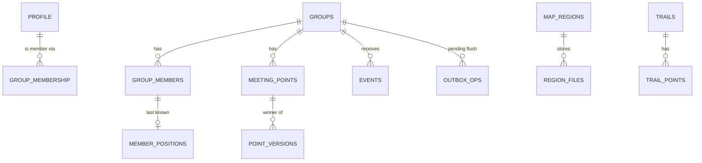

# Data Models

Local SQLite schema, TypeScript domain types, and the projection rules from replicated documents. Wire formats are in `MESH_PROTOCOL.md`.

SQLite: WAL, `foreign_keys=ON`, migrations by `PRAGMA user_version`. Times are integer epoch milliseconds. Coordinates are `REAL` degrees (WGS84). Ids are ULID text.

## 1. Entity overview



## 2. Schema (v1 sketch)

```sql
CREATE TABLE app_profile (
  id            INTEGER PRIMARY KEY CHECK (id = 1),
  address       TEXT,                 -- SDK off1… (null until identity_ready)
  display_name  TEXT NOT NULL,
  color         TEXT NOT NULL,
  created_at    INTEGER NOT NULL
);

CREATE TABLE groups (
  id              TEXT PRIMARY KEY,   -- SDK group id ("group:<uuid>")
  name            TEXT NOT NULL,
  role            TEXT NOT NULL,      -- 'admin' | 'member'
  epoch           INTEGER,
  min_app_version TEXT,
  protocol_v      INTEGER NOT NULL DEFAULT 1,
  created_at      INTEGER NOT NULL,
  joined_at       INTEGER NOT NULL,
  left_at         INTEGER             -- soft delete
);

CREATE TABLE group_members (
  group_id      TEXT NOT NULL REFERENCES groups(id) ON DELETE CASCADE,
  address       TEXT NOT NULL,
  name          TEXT,
  color         TEXT,
  role          TEXT,
  app_version   TEXT,
  sharing       INTEGER NOT NULL DEFAULT 0,
  status        TEXT,                 -- moving|resting|arrived|help|offline
  status_note   TEXT,
  status_rev    INTEGER,
  last_heard_at INTEGER,              -- receiver clock, any doc/event/peer sighting
  last_doc_at   INTEGER,              -- last member-doc change received
  PRIMARY KEY (group_id, address)
);

CREATE TABLE member_positions (       -- last known only, one row per member
  group_id    TEXT NOT NULL,
  address     TEXT NOT NULL,
  lat REAL NOT NULL, lon REAL NOT NULL,
  acc_m REAL, alt_m REAL, speed_mps REAL, heading_deg REAL, battery_pct INTEGER,
  precision   TEXT NOT NULL,          -- exact|100m|1km
  fix_at      INTEGER NOT NULL,       -- sender GPS clock
  received_at INTEGER NOT NULL,       -- my clock
  seq         INTEGER NOT NULL,
  PRIMARY KEY (group_id, address)
);

CREATE TABLE meeting_points (         -- projection: the winning version
  id          TEXT NOT NULL,
  group_id    TEXT NOT NULL REFERENCES groups(id) ON DELETE CASCADE,
  kind        TEXT NOT NULL,          -- meeting|waypoint|hazard|camp
  name        TEXT NOT NULL,
  lat REAL NOT NULL, lon REAL NOT NULL,
  radius_m    INTEGER NOT NULL DEFAULT 30,
  note        TEXT,
  rev         INTEGER NOT NULL,
  author      TEXT NOT NULL,
  updated_at  INTEGER NOT NULL,       -- version ts (display)
  deleted     INTEGER NOT NULL DEFAULT 0,
  PRIMARY KEY (group_id, id)
);
CREATE INDEX meeting_points_geo ON meeting_points(group_id, lat, lon);

CREATE TABLE point_versions (         -- every version seen, bounded (keep newest 20 per point)
  group_id TEXT NOT NULL, point_id TEXT NOT NULL, author TEXT NOT NULL,
  rev INTEGER NOT NULL, ts INTEGER NOT NULL, body TEXT NOT NULL,   -- JSON
  PRIMARY KEY (group_id, point_id, author, rev)
);

CREATE TABLE events (                 -- inbox, deduped by envelope id
  id TEXT PRIMARY KEY, group_id TEXT NOT NULL, type TEXT NOT NULL,
  author TEXT NOT NULL, sent_ts INTEGER, received_at INTEGER NOT NULL,
  sdk_message_id TEXT, body TEXT NOT NULL, handled INTEGER NOT NULL DEFAULT 0
);
CREATE INDEX events_group_time ON events(group_id, received_at);

CREATE TABLE outbox_ops (             -- local changes not yet confirmed flushed
  id INTEGER PRIMARY KEY AUTOINCREMENT,
  group_id TEXT NOT NULL, doc_id TEXT NOT NULL, collection TEXT NOT NULL,
  key TEXT NOT NULL, value TEXT,      -- JSON text, null = clear
  created_at INTEGER NOT NULL, flushed_at INTEGER
);

CREATE TABLE share_settings (
  group_id TEXT PRIMARY KEY, sharing INTEGER NOT NULL DEFAULT 0,
  precision TEXT NOT NULL DEFAULT 'exact', interval_mode TEXT NOT NULL DEFAULT 'auto',
  until INTEGER, pause_on_arrival INTEGER NOT NULL DEFAULT 1, background INTEGER NOT NULL DEFAULT 0
);

CREATE TABLE breadcrumbs (            -- my own track, full precision, local only
  id INTEGER PRIMARY KEY AUTOINCREMENT, ts INTEGER NOT NULL,
  lat REAL NOT NULL, lon REAL NOT NULL, acc_m REAL, alt_m REAL
);

CREATE TABLE map_regions (
  id TEXT PRIMARY KEY, name TEXT NOT NULL,
  min_lat REAL, min_lon REAL, max_lat REAL, max_lon REAL,
  min_zoom INTEGER, max_zoom INTEGER,
  bytes INTEGER, sha256 TEXT, osm_data_date TEXT, schema_v INTEGER,
  state TEXT NOT NULL,                -- available|downloading|verifying|installed|failed
  progress_bytes INTEGER DEFAULT 0, file_path TEXT, installed_at INTEGER, source TEXT  -- catalog|import
);

CREATE TABLE trails (
  id TEXT PRIMARY KEY, name TEXT NOT NULL, source_file TEXT,
  length_m REAL, ascent_m REAL, descent_m REAL,
  min_lat REAL, min_lon REAL, max_lat REAL, max_lon REAL,
  point_count INTEGER, imported_at INTEGER NOT NULL, geojson_path TEXT   -- simplified bands on disk
);
CREATE TABLE trail_waypoints (
  trail_id TEXT NOT NULL REFERENCES trails(id) ON DELETE CASCADE,
  idx INTEGER NOT NULL, name TEXT, lat REAL NOT NULL, lon REAL NOT NULL, PRIMARY KEY (trail_id, idx)
);

CREATE TABLE kv (key TEXT PRIMARY KEY, value TEXT NOT NULL);   -- catalog etag, last_seen, flags
CREATE TABLE schema_info (version INTEGER NOT NULL);
```

Full-resolution trail points are kept in a file next to the simplified bands, not in rows (avoids 50k-row inserts on the JS thread). `trail_points` table is deliberately absent.

## 3. Domain types (TypeScript, zod-backed)

```ts
type Address = string;            // 'off1…'
type GroupId = string;            // SDK group id
type Ulid = string;

interface Fix { lat: number; lon: number; accM: number; altM?: number; speedMps?: number;
                headingDeg?: number; fixAt: number }
interface PositionRecord { v: 1; lat: number; lon: number; acc?: number; alt?: number; spd?: number;
                           hdg?: number; fix: number; seq: number; bat?: number; prec: 'exact'|'100m'|'1km' }
interface MeetingPointVersion { v: 1; id: Ulid; rev: number; author: Address; ts: number;
  name: string; lat: number; lon: number; radiusM: number; note?: string;
  kind: 'meeting'|'waypoint'|'hazard'|'camp'; deleted: boolean }
interface EventEnvelope { tm: 1; id: Ulid; t: string; a: Address; ts: number; p: unknown }
```

Validation bounds: name <= 80 chars, note <= 500, `|lat| <= 90`, `|lon| <= 180`, `radiusM` 5-2000, `rev` safe integer, JSON value <= 4 KiB.

## 4. Projection rules (replicated -> SQLite)

Triggered by `data_changed(space_id, doc_id)` and on start / peer return:

1. Read `docJson(spaceId, docId)`; zod-parse each record; drop invalid ones and count them (diagnostics).
2. Ignore docs for addresses not in the current MLS roster.
3. `m.<addr>.profile/status/share` -> `group_members` (accept only if the record's `rev`/`ts` is newer than stored for `status`).
4. `m.<addr>.pos` -> `member_positions` if `(seq, fix)` newer than stored; `null` -> mark `sharing=0` and keep last position flagged stale.
5. `m.<addr>.points/<id>` -> `point_versions`; recompute the winner for `<id>` = max `(rev, author)` across authors; upsert `meeting_points`.
6. All upserts in one transaction per doc; emit repository change events after commit.

Projection is a pure function `(currentRows, docJson) -> mutations`, unit-tested with property tests: **order independence** (shuffling docs and edits yields identical rows), **idempotence** (applying twice = once), **monotonicity** (never regresses `rev`/`seq`).

## 5. Outbound path

1. Service writes SQLite (e.g. new `point_versions` own row + `meeting_points` projection) and an `outbox_ops` row in one transaction.
2. Lane applies `mapSet` to my member doc and `flush` (throttled); on `data_changed` for my doc, mark ops `flushed_at`.
3. On start: re-apply unflushed ops (idempotent) before enabling the UI "synced" indicator.
4. Compact `outbox_ops` (delete flushed older than 24 h).

## 6. Retention and deletion

| Data | Default retention | Notes |
|---|---|---|
| `member_positions` | 3 days after `received_at` | Purged on leave group |
| `breadcrumbs` | 7 days | Local only; never sent |
| `events` | 30 days | |
| `point_versions` | newest 20 per point | |
| Map files | until user deletes | Show size |
| Everything | "Delete all data": destroy SDK instance, `wipePersistedState`, drop DB, delete files | Rotates identity (irreversible) |

## 7. Migrations

- Numbered SQL files, each run in a transaction, `user_version` bumped last.
- CI test: create DB at v1, apply each migration sequentially with representative data, assert schema and row survival.
- Never edit a shipped migration; add a new one. Destructive migrations require an export-to-file step first.

## 8. Replicated document size budget

| Document | Typical | Hard limit (SDK) |
|---|---|---|
| `m.<addr>` | 2-10 KB (profile, status, pos, <= 200 points) | 1 MiB compacted, warn at 768 KiB |
| `group` | < 1 KB | |

Handle `data_doc_size_warning` and `data_doc_unsyncable` (surface in Diagnostics). A member with > 200 authored points is blocked from adding more with an explanation.
