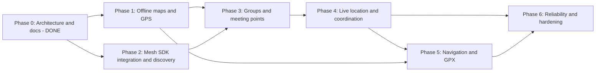

# Development Plan

Six phases. Each phase has its own spec in `docs/phases/`. Status is tracked in `PROGRESS.md`.

Phases 1 and 2 are independent and can run in parallel (two people, or interleaved). Phase 5's GPX/navigation parts depend only on Phase 1 and can be pulled forward if the group features slip.

## Requirement coverage

| # | Requirement | Phase |
|---|---|---|
| 1 | Downloadable offline maps | 1 |
| 2 | GPS current location | 1 |
| 3 | Offline markers and meeting points (local) | 1 (local), 3 (shared) |
| 4 | Nearby device discovery | 2 |
| 5 | Group creation and joining | 3 |
| 6 | Mesh "Pub/Sub" messaging | 2 (transport), 3-4 (lanes) |
| 7 | Share meeting points (lat/lon) | 3 |
| 8 | Periodic member location sharing | 4 |
| 9 | Member markers and last-known positions | 4 |
| 10 | Status updates and arrival notifications | 4 |
| 11 | Straight-line navigation (distance, bearing) | 5 |
| 12 | GPX import and visualisation | 5 |
| 13 | Local-first storage and sync | 3 (store), 6 (hardening) |
| 14 | Reconnection and missed-event sync | 4 (basic), 6 (full) |
| 15 | Privacy controls | 4 (controls), 6 (audit) |

## Cross-cutting rules

- **No phase is done** without: acceptance criteria met, automated tests green in CI, the physical-device checklist executed on the minimum device matrix with results recorded in `PROGRESS.md`, docs updated.
- **Device matrix (minimum):** 2 iPhones (one older, iOS 16+ or the SDK minimum), 2 Android phones (one Android 12-, one Android 13+; ideally one Samsung/Xiaomi for OEM background behaviour), plus a 3rd and 4th device for multi-hop tests from Phase 4. Simulators and emulators cannot validate BLE (A-09).
- **Spikes are time-boxed (2-3 days) with explicit go/no-go criteria** recorded as ADRs in `docs/adr/` (created when the first spike lands).
- **Risk retirement order:** PMTiles spike (S1-1), SDK build (P2-1), **subscription live lane spike (S4-1, pulled forward to right after Phase 2 because it is the demo's core)**, DataStore over BLE (P3-5), background (Phase 6).
- **Group-backed topics (ADR 0036) are not a prerequisite.** Build on per-person subscriptions. Decide on ADR 0036 using Phase 4 metrics (see `PHASE_4.md`).
- **Feature flags** for anything platform-risky (background sharing, Wi-Fi Direct, service-subscription live lane).
- **Definition of Ready** for a phase: previous phase exit criteria met or explicitly waived in `PROGRESS.md`.

## Release strategy

1. Internal builds (TestFlight internal / Play internal) from Phase 2 onward for device testing.
2. Closed beta after Phase 5 with a real trail trial.
3. Public release after Phase 6, contingent on the licence decision.

## Estimated effort (one experienced RN engineer, rough)

| Phase | Weeks |
|---|---|
| 1 | 3-4 |
| 2 | 2-3 |
| 3 | 3 |
| 4 | 3-4 |
| 5 | 2-3 |
| 6 | 4 |

Estimates exclude the field trials' calendar time and app-store review. They are planning numbers, not commitments.

## Phase index

- [Phase 1: Offline Maps and GPS](phases/PHASE_1.md)
- [Phase 2: Mesh SDK Integration and Peer Discovery](phases/PHASE_2.md)
- [Phase 3: Groups and Meeting Point Sharing](phases/PHASE_3.md)
- [Phase 4: Live Location and Group Coordination](phases/PHASE_4.md)
- [Phase 5: Offline Navigation and GPX Trails](phases/PHASE_5.md)
- [Phase 6: Reliability, Synchronization and Production Hardening](phases/PHASE_6.md)
