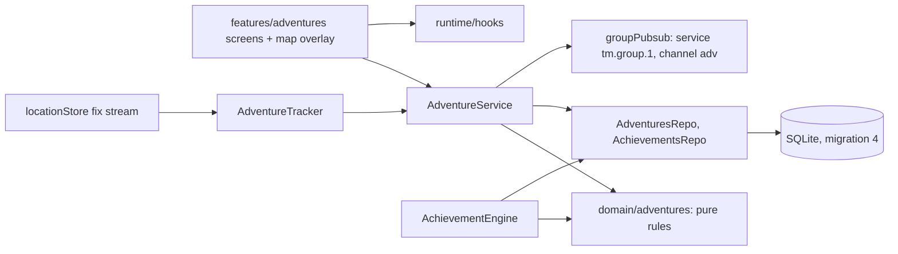

# Adventures and achievements: architecture

Companion to `ARCHITECTURE.md`, `MESH_PROTOCOL.md` (section 10), `DATA_MODELS.md` (Phase 7) and `DESIGN_SYSTEM.md` (section 14). Feature list: `GAMIFICATION_FEATURES.md`. Status and open items: `GAMIFICATION_PROGRESS.md`. Evidence: `GAMIFICATION_TEST_REPORT.md`.

Muster stays a navigation and coordination tool first. Adventures add a shared plan (checkpoints), a personal record (time, distance, route) and a small set of milestones. Nothing here needs a network, a backend, a new native module or a change to the SDK.

## 1. Layers



| Piece | Where | Responsibility |
|---|---|---|
| Domain rules | `src/domain/adventures/` | Pure TypeScript, no React Native, no SDK. `model` (types, zod wire schemas), `lifecycle`, `arrival`, `track`, `merge`, `authorize`, `stats` (progress, timeline, recap), `achievements`, `route` |
| Persistence | `src/data/repositories/AdventuresRepo.ts`, migration 4 | Adventures, checkpoints, completions, participants, status log, route, unlocks |
| Service | `src/features/adventures/AdventureService.ts` | Commands (create, edit, lifecycle, checkpoints, join/leave, confirm arrival), publishing, inbound handling, reconciliation after reconnecting |
| Tracker | `AdventureTracker.ts` | Turns the existing fix stream into route, distance and arrival detection. Starts no GPS work of its own |
| Engine | `AchievementEngine.ts` | Collects local facts, evaluates, records each unlock once |
| UI | `AdventuresScreens`, `CheckpointScreens`, `RecapScreens`, `map/AdventureOverlay`, `ui/motion`, `ui/BadgeMark` | Reuses `Screen`, `Card`, `ListRow`, `Button`, `Banner`, `SegmentedTabs`, `IconTile`; adds only `BadgeMark`, `Reveal`, `PulseRing`, `AnimatedProgress` |

Dependency rules hold: `domain` imports nothing outside itself; `ui` imports React Native and `shared` only; `features/adventures` is added to the "features never import each other" list in `.eslintrc.js`, so it reaches other features only through `runtime/services` and `runtime/hooks`. `src/mesh/sdk.ts` is still the only SDK importer: this feature never touches the SDK, only `PubSub`.

## 2. Lifecycle

```
Planned --start--> Active <--pause/resume--> Paused
   |                 |                         |
   |                 +------complete-----------+--> Completed
   +--cancel--> Cancelled   (cancel also from Active and Paused)
```

`transition(status, action)` is the only place a local action is validated. `Completed` and `Cancelled` are final. There is no minimum duration and no penalty for ending early.

**Individual versus shared clocks.** The status is shared (the owner decides). Each person's *own* time is derived from it: a running segment opens when the adventure is `active` **and** the person has joined, and closes on pause, completion, cancellation or leaving. `elapsed = closed segments + now - resumedAt`. Only `resumedAt` and `activeMs` are stored, so the clock survives an app kill with no timer. Pauses and rests cost nothing.

When a group header arrives late, closing is clamped to `min(now, max(header.ts, resumedAt))` so a delayed message cannot add time that passed while the adventure was already stopped; opening starts at the moment this device learned of it.

## 3. Checkpoints and arrival detection

A checkpoint has a name, a position, an optional description, an optional icon (its kind: entrance, viewpoint, waterfall, campsite, rest stop, summit, final destination, other) and a completion record per person.

`proximity({fix, target, radiusM, now})` is pure:

| Input | Verdict |
|---|---|
| no fix, fix older than 15 s, non-finite accuracy, fix from the future | `no_fix` |
| accuracy worse than `max(radius, 20)` (capped at 100 m) and the error circle could contain the target | `uncertain` |
| accuracy good, distance <= radius | `inside` |
| accuracy good, distance <= 4 x radius | `approaching` |
| otherwise | `far` |

`stepDwell` then requires **two** consecutive `inside` readings at least 3 s apart; anything else (including a missing fix) resets the streak. So a single GPS spike, a weak fix, or standing near the edge never marks an arrival. The radius is a setting (15 to 150 m, default 30, kv key `pref.checkpointRadiusM`).

`uncertain` never marks an arrival. It shows "Near X, GPS is too weak to confirm" with an "I am here" button. Manual confirmation is always allowed while the adventure is running; from more than ten radii away the app asks once first. Manual and automatic arrivals are both stored with their `method`, and the recap says which was which.

Arrival detection only runs for adventures whose clock is running for this person. No code path in checkpoint validation uses the network.

**Route and distance.** `appendFix` drops fixes worse than 50 m, drops jumps faster than 15 m/s (a glitch, not a hiker), and adds a point only after a step larger than `max(8 m, min(accuracy, 25 m))`, so standing still records nothing. A new running segment starts a new leg, so the time between legs never becomes a straight line. Up to 20,000 points per adventure are stored; beyond that distance still counts. Distance is shown but never rewarded on its own.

## 4. Replication

Group adventures use the existing group service. **No new service, no new SDK primitive, no change to an existing topic.** One additive channel, `adv`, is added in each direction (`tm/1/<group>/adv`). It is followed with the same subscription handshake as the other group channels; a build without adventures refuses that one subscription and keeps working. Full protocol: `MESH_PROTOCOL.md` section 10.

- **Single writer.** The group organizer writes the adventure header (name, status, revision) and checkpoints. Each member writes only their own arrivals and their own participation. The organizer *relays* member records on its own topic; a relay is an attestation ("I received this from that member"), never authorship.
- **State is canonical, events are hints.** Everything a late member needs is in SQLite and is re-published when a follower becomes active, and again on a `adv_sync` request. Losing every message loses only immediacy.
- **Deterministic merge.** Header: highest revision wins, but a revision that asks for something no legal sequence can produce (leaving a final status, going back to planned, another group's id) is refused, not merged. Checkpoint: highest revision, tombstones. Arrival: a grow-only set; the earliest report of the same arrival wins. Participation: highest per-participant `seq`. All are idempotent and independent of arrival order (tested over all orders).
- **Authorization** (`domain/adventures/authorize.ts`). The SDK `provider` is the only trusted identity. Shared state is accepted only from the organizer recorded when this device created or joined the group. Member messages are accepted only by the organizer, only from an active roster member naming themselves, only for an adventure of that group, only for a live checkpoint, never for a planned or cancelled adventure, and not from someone who left it.
- **Deduplication.** `PubSub` drops a repeated envelope id (memory and the `events` table, so across restarts). Below that, the merge rules make a re-sent record a no-op.
- **Confirmation without over-claiming.** A member's arrival is shown as confirmed by the organizer only when the organizer's relay of it came back (`published`). "Handed to the radio" is never presented as delivered.

Not every member is assumed connected: arrivals made out of range stay unconfirmed and are retried when the organizer follows the member again and every 30 s.

## 5. Achievements

Definitions are typed constants (`ACHIEVEMENTS`, 13 badges: id, name, description, requirement text, category, icon, target). Unlocks are rows `(id, unlocked_at, adventure_id?)`; the first unlock wins and is never overwritten. A badge stays earned if its adventure is later deleted from the journal.

`evaluate(facts)` is pure. The engine builds `facts` only from local records and re-runs when adventures or meeting points change (debounced):

| Badge | Evidence used |
|---|---|
| First Adventure, Trail Starter (3), Explorer (10) | Completed adventures that *qualify* (see below) |
| First Summit | A qualifying completed adventure in which this person reached a summit checkpoint |
| Trail Collector | 10 distinct (adventure, checkpoint) completions by this person |
| Weekend Wanderer | Qualifying completions on 3 different weekends, by local calendar (the time zone offset at completion is stored) |
| First Expedition, Together We Go (5) | Qualifying completed group adventures with 2 or more joined participants |
| Trail Companions | 2 or more qualifying group adventures with the same group id |
| Rally Point | Organizer: another member's acknowledgment of a meeting point is stored. Member: holds an organizer's point and has acknowledged it |
| Local Explorer | Every place (start and checkpoints) was inside an installed map region when the adventure was completed |
| Off the Grid | As Local Explorer, plus at least 30 minutes running, plus **no network use** recorded while it ran |
| Mesh Connected | A message from an active roster member (or the organizer) arrived over the group service while that group's adventure was running |

**Qualifying.** Pressing Start then Finish must not earn anything. An adventure counts when this person reached at least one checkpoint, or ran at least 20 minutes and recorded at least 300 m. Distance is a gate against an empty trip, not a reward. Cancelled adventures never count.

**What "no network use" means.** App code that uses the network is limited to `features/maps-manager` (CLAUDE.md rule 6). The HTTP client is wrapped so any request marks the adventures running at that moment, and the map marks them while it streams the online map ("Online map · not saved"). This proves Muster did not use the network. It does **not** prove the phone had no signal, and the badge copy says "Muster used no network".

**Honesty.** Badges are computed on the phone from the person's own records. The screen says so and the app never calls them verified. Rally Point and Mesh Connected rest on a *received* message or acknowledgment, never on a successful publish call.

## 6. Privacy, safety and integrity

- Joining an adventure is opt-in per person; planning one for a group does not enrol anyone. **No position is ever published.** Arrivals carry the checkpoint id, a time and a method, nothing else (tested: the stored envelope contains no `lat`/`lon`). Checkpoint coordinates are shared with the group only for group adventures, as places the organizer chose.
- The route, distance, notes and journal never leave the device. There is no export and no group-visible history.
- No leaderboards, no ranking, no streaks, no currency, no speed or pace statistic. Distance and time appear in the recap as facts, not scores.
- Checkpoint screens carry a safety note (choose safe, public, accessible places; Muster does not know about closures, land access, weather or terrain; turn back if conditions change). The app cannot know which places are unsafe or restricted offline, and says so instead of pretending to.
- Logs never contain coordinates (CLAUDE.md rule 8); rejected messages are logged by reason and short address only.
- No telemetry (rule 9); `enableTelemetry` is not called.

## 7. Battery and performance

- The tracker consumes the fix stream the map already runs; no extra watch, no timer. Writes happen per accepted route point (about one per 8+ m of movement) and per distance step.
- The adventure service polls once every 30 s, and only does mesh work when groups with adventures exist and the mesh is running. Orphan checks are one indexed query.
- The map reloads the drawn route at most every 15 s and thins it to 400 points; checkpoints are one GeoJSON source of at most 20 features.
- Animations: opacity and transform on the native driver, 280 to 320 ms, a pulse that swells twice and stops. The progress bar uses a brief non-native width animation. Everything is skipped under reduced motion, and also until the platform has answered (unknown counts as reduced).
- Large celebrations never appear on the map. The map shows static one-line banners and a three-step marker swell. The fuller reveals live on screens the person opened on purpose (recap, achievements).

## 8. Failure and edge behaviour

| Situation | Behaviour |
|---|---|
| App killed mid-adventure | Status, `resumedAt`, arrivals, route are in SQLite; the clock keeps counting wall time; the tracker restarts a fresh leg |
| GPS lost or weak | Route ignores fixes over 50 m; arrival never auto-confirms; the hint offers manual confirmation |
| Phone clock jumps | Elapsed is clamped at zero, never negative; arrival times from members are capped at the organizer's receive time |
| Organizer out of range | Members keep the last state; their arrivals wait unconfirmed and are retried |
| Duplicate delivery | No change, no repeated notice |
| Conflicting state | Illegal transitions refused; stale revisions ignored |
| Group ends or is left | The group adventure is closed on that device (clock stops, record kept, notice shown) |
| Member removed from the group | The organizer ignores their messages |
| Unknown message type from a newer app | Stored by `PubSub`, ignored |
| Too many records | At most 20 checkpoints, 240 completions per adventure, 12 members |

## 9. What is deliberately not here

Public maps of other people's adventures, social feeds, comparison between people, cloud backup of the journal, GPX export (Phase 5), live position sharing (Phase 4), per-participant invitations to a subset of a group, and editing a group adventure's checkpoints by members. Each is either a privacy decision or a later phase.
