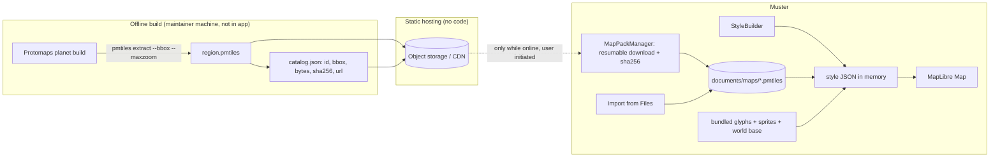

# Map Architecture

Goal: maps, GPS, markers, GPX and navigation work with **no internet and no backend at runtime** once a region is on the device.

## 1. Decision summary

| Concern | Decision | Fallback |
|---|---|---|
| Renderer | `@maplibre/maplibre-react-native` v11 (new architecture only) | `react-native-maps` is not viable offline with open data; no fallback renderer planned |
| Map format | **Vector tiles in PMTiles single-file archives**, one per downloadable region | MapLibre `OfflineManager` packs against a self-hosted tile endpoint |
| Data | OpenStreetMap via **Protomaps basemap builds** (ODbL), extracted per region with the `pmtiles` CLI | Self-built with Planetiler |
| Distribution | Static files on object storage/CDN we control, plus manual import from Files; no server code | Bundled starter region |
| Style assets | Style JSON, sprites and glyph PBFs **bundled in the app** and copied to the documents directory | none (required) |
| GPS | `expo-location` behind `LocationPort`, compass via its heading API | `@react-native-community/geolocation` + `expo-sensors` (verify maintenance in spike) |
| GPX | `fast-xml-parser` -> internal `Track` -> GeoJSON line source | n/a |
| Offline routing | **Out of scope for v1.** Straight-line and track-following only | Future native Valhalla/BRouter module |

Rationale for the headline choice (PMTiles over MapLibre offline packs) is §4.

## 2. Evaluation

### 2.1 Renderer

| Option | Offline vector | New Arch | Licence | Verdict |
|---|---|---|---|---|
| **MapLibre RN v11** | Yes (native MapLibre) | v11 is New-Arch-only [WEB] | BSD-style OSS | **Chosen** |
| MapLibre RN v10 | Yes | Old arch / interop | OSS | Rejected: v11 is current. Latest seen: v11.5.1 on 2026-10-29, bundling MapLibre Native Android 13.6.1 / iOS 6.31.0 (since v11.4.0) [WEB] |
| `@rnmapbox/maps` | Yes | Yes | Mapbox ToS, token, usage billing | Rejected: proprietary SDK terms and token for an offline-first app |
| `react-native-maps` | Apple/Google tiles only | Yes | Platform terms | Rejected: no open offline data |
| WebView + MapLibre GL JS + PMTiles | Yes | n/a | OSS | Rejected: WebView memory/gesture cost, awkward GPS/compass bridging. Kept as an emergency fallback only |

The SDK example apps run RN 0.82.1 with the New Architecture on [SDK], so Muster pins **RN 0.82.x** and MapLibre v11 is compatible with that direction. [ASSUMPTION A-10: exact RN/MapLibre version compatibility confirmed in Phase 1 spike S1-1]

### 2.2 Vector vs raster

| | Vector (MVT) | Raster (PNG/WebP) |
|---|---|---|
| Size per region | Small. Protomaps planet zoom 0-15 is ~120 GB; regions are a tiny slice, and each extra zoom roughly doubles size [WEB] | Much larger at the same zoom range |
| Rotation/tilt | Crisp, labels stay upright | Blurry, labels rotate |
| Styling | Runtime (night mode, trail emphasis) | Baked in |
| Overzoom | Smooth | Pixelated |
| Render cost | GPU style evaluation; fine on mid-range phones | Cheap |

**Vector.** Optional raster overlays (topo, hillshade) are post-v1.

### 2.3 Providers and licensing

- **Do not use the public OSM tile servers for offline.** The OSMF raster policy defines bulk downloading as any pre-emptive fetching other than tiles the user is viewing, and lists "download area for offline use" as prohibited; the vector tile policy likewise lists creating a tile archive. Violations are blocked without notice. [WEB: operations.osmfoundation.org/policies/tiles, /policies/vector]
- **OpenStreetMap data is ODbL.** Tiles derived from it are a Produced Work: visible attribution "© OpenStreetMap contributors" is mandatory on every map screen and in an About screen. [WEB: Protomaps docs]
- **Protomaps basemap**: daily planet builds, `pmtiles extract --bbox` / `--region` / `--maxzoom` produce regional archives; map design CC0, code BSD-3; copy tilesets to our own storage instead of hotlinking. [WEB: docs.protomaps.com]
- Commercial tile APIs (MapTiler etc.) often forbid caching beyond limits; not used.
- Satellite imagery: licensing generally prohibits offline redistribution; excluded.
- Terrain/contours for hiking: desirable, but needs an open DEM pipeline and licence review. Post-v1 (backlog B-1).

### 2.4 Native dependencies

MapLibre Native (C++ core) via the RN wrapper: iOS pod, Android AAR, both autolinked. Adds roughly tens of MB per platform [ASSUMPTION A-11, measure in Phase 1]. No Google Play Services dependency (a plus for degoogled phones); `expo-location` uses the platform fused provider when available.

## 3. Offline architecture

The only network use is the user-initiated pack download. Core navigation never calls out.

### 3.1 Region management (`MapPackManager`)

- **Catalog:** a small static JSON listing regions: `id`, `name`, `bbox`, `minZoom`, `maxZoom`, `bytes`, `sha256`, `url`, `osmDataDate`, `schema` version. Cached locally; a bundled copy covers first run offline.
- **Download:** HTTP range resume, writes `*.part`, verifies SHA-256, atomically renames. State machine `available -> downloading -> verifying -> installed | failed`, stored in SQLite (`map_regions`).
- **Storage:** app documents directory (user-visible size, not auto-purged), excluded from iCloud backup. Show size and `osmDataDate`. Delete, update (new `osmDataDate`), and low-storage guard (refuse if free space < size x 1.2).
- **Import:** open a `.pmtiles` from Files (header validated: magic `PMTiles`, spec version, tile type = MVT, bounds). Lets a trip leader pre-load phones from a laptop.
- **Coverage index:** installed regions' bounds are in SQLite so "is this point covered?" is a pure local query (§6).
- **Sizing guidance** (to be measured, A-12): choose per-region `maxzoom` ~14 and overzoom beyond; each zoom roughly doubles size. Target regions of 50-300 MB.

### 3.2 Style and assets

MapLibre needs more than tiles: glyphs for labels and sprites for icons. Offline, both must be local.

- Ship a **style template** plus glyph PBFs (only the font stacks used) and a sprite sheet in the app bundle; on first launch copy them to `documents/style/` so native code can read them via `file://` paths.
- Android native code cannot do byte-range reads on bundled APK assets, which PMTiles needs. MapLibre's Android docs say bundled assets are unsupported for PMTiles; local files use `pmtiles://file://<absolute path>`. [WEB: MapLibre Native Android PMTiles docs] Hence PMTiles live on the filesystem, never in the bundle. Bundled starter data (world z0-z5 base) is copied out on first launch.
- `StyleBuilder` generates the style at runtime: one vector source per installed region (`pmtiles://file://…`) plus the world base, with layer sets generated per source (the `@protomaps/basemaps` style library takes a source name). Regions overlap; draw order is world base first, then regions, newest data last. [ASSUMPTION A-13: multiple PMTiles sources with duplicated layers perform acceptably on mid-range phones; else merge regions into one archive at install time]
- Overlays (markers, members, GPX, breadcrumbs, navigation line) are separate GeoJSON sources/layers drawn above, **independent of tile availability**.

### 3.3 Why not MapLibre offline packs as primary?

MapLibre's `OfflineManager.createPack` takes a style URL, zoom range and bounds and downloads tiles through the network source. [WEB] It needs a live tile endpoint at download time (a server or CDN that serves z/x/y), and per MapLibre Native docs **PMTiles sources do not support offline pack downloads or caching**. [WEB] A file-based PMTiles flow gives: a single verifiable artifact, no tile server, trivial import/share, deterministic size, and works identically on both platforms. Packs remain the documented fallback if the PMTiles-through-RN path fails the spike.

### 3.4 Critical unknown (must be settled first)

No source found confirms that the RN v11 wrapper passes `pmtiles://file://…` through unchanged on **both** platforms. [WEB: gap] Native MapLibre supports it from Android 11.7.0 / iOS 6.10.0 and the bundled natives (13.6.1 / 6.31.0) are newer, so likelihood is high, but it is an assumption (A-14).

**Phase 1 spike S1-1 is a go/no-go gate** on a physical iPhone and Android phone in airplane mode: render a local PMTiles region, pan/zoom, rotate. Failure path, in order:
1. Local HTTP server on loopback inside the app serving z/x/y from the PMTiles file (adds a native/JS server dependency, keeps vector tiles).
2. Convert regions to MBTiles and use a native MBTiles-capable path.
3. Hosted tile endpoint + `OfflineManager` packs.
Each fallback is isolated behind `TileSourceStrategy` so the rest of the app is unaffected.

## 4. GPS and compass

- `LocationPort`: `getCurrentFix()`, `watch(options)`, `permissionState()`, `requestPermission()`, emits `Fix{lat, lon, accuracyM, altM?, speedMps?, headingDeg?, fixTime}`. Adapter: `expo-location` (added via expo-modules in the bare app). [WEB: Expo docs; ASSUMPTION A-15 on bare-RN integration]
- `HeadingPort`: device heading (true when available) at ~5 Hz, throttled; calibration prompt on low accuracy.
- GPS works with no connectivity (satellites, plus A-GPS only if previously cached). **Cold start can take minutes without assistance data**; the UI shows "acquiring" and never blocks.
- Foreground by default. Background tracking adds platform requirements (§7).
- Permission flow: explain-then-ask; handle denied / "approximate only" (iOS reduced accuracy -> treat as degraded, warn; navigation needs precise).
- Accuracy gate: fixes with `accuracyM > 100` are shown but not shared as exact and not used for arrival.
- Adaptive sampling: moving -> 2-5 s local UI updates, 10-15 s shared; stationary -> slower, with a distance filter. Details in `ARCHITECTURE.md` §10.

## 5. Markers, meeting points and layers

| Layer | Source | Notes |
|---|---|---|
| Basemap | PMTiles | |
| My location | GPS | accuracy circle, heading cone |
| Members | `member_positions` | colour per member, age badge, stale style after 5 min |
| Meeting points / waypoints | `meeting_points` (projection) | symbol layer, tap -> sheet |
| GPX tracks | `trails` GeoJSON | simplified per zoom, start/end markers |
| Breadcrumb (own) | `breadcrumbs` | optional, retention-limited |
| Navigation line | computed | dashed straight line to target |

Marker data is **GeoJSON built from SQLite** and pushed to MapLibre sources; the map is a view, never a store. Cluster when > 50 symbols. Custom marker bitmaps come from the bundled sprite sheet.

## 6. Missing-data behaviour

- Always bundled: world base z0-3 (2.4 MB measured; z0-5 is 15 MB, see ADR 0002), so there is a recognisable coastline/country context everywhere.
- If the camera centre is outside every installed region and zoom > base: show a non-blocking banner "No offline map for this area" with **Download** (when online) and **Import**; overlays still render on a plain background with a lat/lon grid.
- Navigation (distance/bearing) never depends on tiles.
- Coverage test: `RegionIndex.covers(lat, lon)`.

## 7. Background and platform rules (assumptions until device-tested)

| | iOS | Android |
|---|---|---|
| Foreground | Location "When In Use" | `ACCESS_FINE_LOCATION` |
| Background tracking | Background location mode + Always (or When In Use with background indicator); App Review needs a justified purpose string | `ACCESS_BACKGROUND_LOCATION` (separate prompt, Play review) + foreground service of type `location`; the SDK already runs a `connectedDevice` foreground service [SDK], types must be combined in the merged manifest |
| Battery impact | Significant-change mode is insufficient for sharing | Doze and OEM killers (Xiaomi, Samsung) can stop it |

v1 policy: **foreground-first**, "keep awake while navigating" option, and an opt-in "share while app is in background" setting built in Phase 6 after measuring battery (A-16). The UI always states when sharing is paused due to backgrounding.

## 8. Rendering performance

- Budget: 60 fps pan/zoom on a 2020 mid-range Android; marker updates batched (<= 1 Hz for others, 2-4 Hz for self); GeoJSON updates diffed.
- GPX: simplify with Douglas-Peucker to a screen tolerance (e.g. 2 px at the current zoom), pre-computed at import for 3 zoom bands; tracks > 50k points are simplified at import and the full-resolution copy kept on disk for statistics.
- Avoid React re-render of the map on every fix: use refs + imperative camera/source updates.
- Cap simultaneous region sources (default 3 active, rest on demand).

## 9. GPX

- Import via file picker/open-in; parse `<trk><trkseg><trkpt>`, `<rte><rtept>`, `<wpt>` with `fast-xml-parser` (Hermes has no DOM, so DOM-based GPX parsers are out). Reject > 25 MB; handle namespaces, missing `ele`/`time`.
- Internal model `Track{id, name, points[lat,lon,ele?,t?], bbox, lengthM, ascentM}`; waypoints become importable meeting-point candidates.
- Follow-trail mode: nearest point on line (Turf `nearestPointOnLine`), distance along track remaining, off-track deviation with alert threshold (default 50 m). No routing needed.
- Sharing a GPX with the group over BLE is **not** a v1 feature (size, bandwidth). Option: share a trail by reference (name + hash + bbox) so members import the same file.

## 10. Offline routing assessment

| Option | Offline | Verdict |
|---|---|---|
| Valhalla / OSRM / GraphHopper embedded | Possible in native code with routing tiles | No maintained RN integration was verified; large data per region and build complexity. **Not v1** |
| BRouter (Android app/engine) | Yes, Android only | Platform-split. Not v1 |
| Straight-line + bearing + GPX following | Yes | **v1.** Matches the stated requirement |

If routing is added later, it plugs into `NavigationService` through a `RouterPort`.

## 11. Risks

| ID | Risk | Mitigation |
|---|---|---|
| M-1 | PMTiles-through-RN path fails on one platform | Spike S1-1 go/no-go + ordered fallbacks (§3.4) |
| M-2 | Region file sizes too big for phones | Zoom cap, regions by bbox, show size before download |
| M-3 | OSM data becomes stale | `osmDataDate` shown, update flow, no silent refresh |
| M-4 | Background location approvals | Foreground-first; defer to Phase 6 |
| M-5 | Style/glyph/sprite assets missing offline cause blank labels | CI test that loads the style with the network blocked |
| M-6 | Attribution omitted | Non-removable attribution control + About screen; checked in acceptance tests |

## Custom areas (any region, on the device)

Beyond the catalog's fixed regions, a user can download whatever the map shows. The app does what `pmtiles extract` does, on the phone, using HTTP range requests against a hosted **planet** PMTiles archive (`planet` in `catalog.json`, set with `build.mjs --planet-url`):

1. Read the first 16 KiB (header, root directory), then only the leaf directories that can contain tiles inside the area (`RegionExtractor.planArea`). No tile data is fetched, so the exact download size is known before the user commits.
2. Group the needed tile blocks into range requests (gaps up to 64 KiB are merged, at most 8 MiB per request) and write a new archive: header, gzipped root and leaf directories, metadata, tiles (`extractArea`). Identical tiles stay deduplicated.
3. Validate the header and move the file into place like any other region (`source = 'custom'`).

Limits and behaviour: at most 600,000 tiles or 2 GiB per area; detail levels cap at zoom 12 / 14 / 15. Custom areas cannot resume: cancelling or killing the app discards the partial file. The planet host must support `Range` and CORS-free direct access; host your own copy (docs/PROGRESS.md D-3), never hotlink the Protomaps build server or use OSM tile servers. Place-name search is not implemented: users pan the map to the place.

### Online map until something is downloaded, and place search

- While no installed region covers the camera centre, `StyleBuilder` adds the planet archive as a remote `pmtiles://https://…` source (same layers, same style) above zoom 3, and the map shows an "Online map · not saved" pill. Once a downloaded region covers the view the remote source is dropped. Nothing is cached by the app; MapLibre's ambient cache may keep tiles. Needs a planet URL (`planet` in the catalog, or `devPlanet()` in debug builds). [ASSUMPTION A-25: MapLibre Native streams a remote PMTiles archive over HTTPS on iOS and Android; not verified on a device.]
- Place search (`PlaceSearch`) calls the public Nominatim geocoder only when the user submits a query (policy: identifying User-Agent, at most one request per second, no type-ahead). Choosing a result moves the map there and opens the download sheet for the result's area; point results (a peak, a village) get a 0.1 degree box. Development/testing only: replace the base URL with your own geocoder before shipping.
- Not used: `Cyclenerd/offline-map-tile-downloader` is a desktop Go tool that bulk-downloads raster tiles from third-party tile servers, which the OSM tile policy prohibits and which does not fit the vector PMTiles pipeline.
