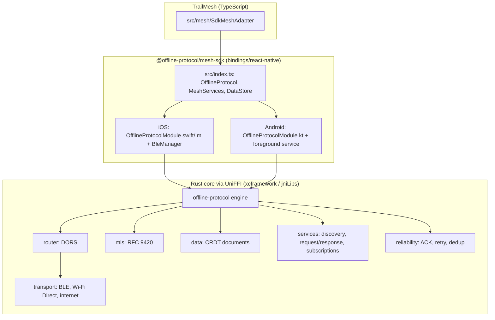

# SDK Integration

Findings from inspecting `../offline-protocol-sdk` (package `@offline-protocol/mesh-sdk` 0.31.0, `bindings/react-native/package.json`), and how TrailMesh consumes it.

Evidence labels used throughout the docs:

- **[SDK]** stated in SDK source or docs; the file is cited.
- **[WEB]** from a web source checked on 2026-10-30.
- **[ASSUMPTION]** inferred, not verified. Each has an ID (`A-xx`) and is closed by a device test or spike in `DEVELOPMENT_PLAN.md`.

The SDK repository was inspected read-only and must stay unmodified.

## 1. SDK architecture

A Rust workspace (`offline-protocol-sdk/CLAUDE.md`) exposed to Swift, Kotlin, Python and React Native through UniFFI.



Key facts:

| Topic | Finding | Source |
|---|---|---|
| RN binding | `OfflineProtocol`, `MeshServices`, `DataStore` classes in `bindings/react-native/src/index.ts`; types in `src/types.ts` | [SDK] |
| Native bridge | Hand-maintained Swift + Obj-C `RCT_EXTERN_METHOD` on iOS, `@ReactMethod` Kotlin on Android | [SDK] `WIRING_GUIDE.md` |
| New Architecture | Example app runs RN 0.82.1 with `newArchEnabled=true` | [SDK] `examples/react-native-app/android/gradle.properties`, `package.json` |
| Platforms | RN >= 0.70, iOS >= 13.0, Android minSdk 24 | [SDK] `bindings/react-native/README.md`, podspec |
| Transports | BLE, Wi-Fi Direct (Android only), internet relay, Reticulum, Nostr. TrailMesh uses BLE (+ Wi-Fi Direct on Android) | [SDK] `docs/react-native-integration.md` §4 |
| Encryption | MLS (RFC 9420), on by default, auto-initialised on `start()` | [SDK] |
| Licence | AGPL-3.0-only or commercial, but the SDK is company-owned and TrailMesh is an internal demo of the pub/sub model, so licensing is not a constraint (owner decision, 2026-10-30) | [SDK] `docs/licensing-faq.md` |

## 2. Local build and linking

The SDK ships prebuilt natives only in its npm package. From a source checkout the native libraries do not exist until built (`bindings/react-native/ios/libs` and `android/src/main/jniLibs` are absent). [SDK]

### 2.1 Prerequisites (one-time, outside the repo)

```bash
rustup target add aarch64-apple-ios aarch64-apple-ios-sim x86_64-apple-ios \
  aarch64-linux-android armv7-linux-androideabi x86_64-linux-android i686-linux-android
cargo install uniffi --version 0.32.2 --features cli --locked   # must match workspace pin
# Xcode, Android NDK (ANDROID_NDK_HOME), JDK 17
```

### 2.2 Build

```bash
cd ../offline-protocol-sdk/bindings/react-native
npm install
npm run build:all        # = build-uniffi-all.sh: native libs AND regenerated bindings together
```

Notes:

- The scripts build with `cargo build --profile mobile` for 3 iOS and 4 Android targets (`scripts/build-uniffi-ios.sh`, `build-uniffi-android.sh`). [SDK]
- **This writes build artifacts inside the SDK tree** (`target/`, `ios/libs`, `android/.../jniLibs`, `lib/`). It does not modify SDK source, but it is not "read-only". **Confirmed in Phase 2 (A-01, iOS):** `git status` in the SDK was clean before and after `npm install` + `npm run build:uniffi:ios`; all artifacts are git-ignored, and the regenerated Swift/Kotlin/Python/Ruby/Java bindings were byte-identical to the committed ones (so uniffi 0.32.2 matches). Android: same result for `npm run build:uniffi:android` (SDK `git status` clean afterwards); `jniLibs/` is git-ignored.
- **Disk:** the host had ~13 GiB free at 94% usage on 2026-10-30 and `target/` is already 1 GB. A full 7-target build can take several GB more. Run it one repo at a time and check `df -h` first.
- `npm run build:all` regenerates bindings; if it produces diffs in tracked files (`ios/Generated`, `uniffi/.../offline_protocol.kt`) that is a signal the uniffi version differs. Stop and reconcile, do not commit to the SDK.

### 2.3 Linking into TrailMesh

Same mechanism as the SDK's own examples (`examples/react-native-app/package.json`: `"@offline-protocol/mesh-sdk": "file:../../bindings/react-native"`).

`trailmesh/package.json`:

```json
"dependencies": { "@offline-protocol/mesh-sdk": "file:../offline-protocol-sdk/bindings/react-native" }
```

`metro.config.js` must (copying the pattern in the SDK example):

- add `../offline-protocol-sdk/bindings/react-native` to `watchFolders`;
- `extraNodeModules` map `@offline-protocol/mesh-sdk` to that folder, and `react`/`react-native` to TrailMesh's own `node_modules`;
- `blockList` the SDK folder's own `node_modules/react` and `react-native` so there is exactly one copy of each.

iOS: autolinking resolves `MeshSdk.podspec` at the package root, `pod install`. Android: autolinking via `react-native.config.js`. [SDK]

### 2.4 Switching to the published package later (requirement)

Three rules keep the swap to a one-line change:

1. **One import site.** Only `src/mesh/sdk.ts` imports `@offline-protocol/mesh-sdk`. Everything else depends on `MeshPort` (`ARCHITECTURE.md` §4). A lint rule (`no-restricted-imports`) enforces it.
2. **No deep imports** (`@offline-protocol/mesh-sdk/src/...`). Only the package root export.
3. **A switch script** `scripts/sdk-source.sh local|npm <version>`:
   - `local`: sets the `file:` dependency, enables the Metro SDK overrides (`TRAILMESH_SDK=local`), runs `npm install` and `pod install`.
   - `npm`: `npm install @offline-protocol/mesh-sdk@<version>`, disables the overrides.
   The Metro config reads `TRAILMESH_SDK` so no code change is needed. The published package contains `lib/`, `ios/libs` and Android natives (`package.json` `files`), so no Rust toolchain is needed in `npm` mode.

CI runs both modes (Phase 6) so the swap cannot rot.

### 2.5 Rebuilding after a local SDK change

| What changed in the SDK | Do |
|---|---|
| TypeScript (`bindings/react-native/src`) | `cd ../offline-protocol-sdk/bindings/react-native && npm run build` (refreshes `lib/` types), then restart Metro with `npx react-native start --reset-cache`. Metro itself reads `src/index.ts`. |
| Rust, UDL, Swift, Kotlin | `npm run build:uniffi:ios` and/or `npm run build:uniffi:android` (or `build:uniffi:all`) in the same folder. Then `cd ../trailmesh/ios && pod install` and rebuild the app. For Android, rebuild with Gradle (`cd android && ./gradlew :app:assembleDebug`). |
| Switching back to the package | `scripts/sdk-source.sh npm <version>` (and `local` to return) |

Before a native build run `df -h /` (needs roughly 5 GiB free for iOS alone on this machine; the three iOS targets wrote about 1.7 GiB into `target/`) and run one repo at a time. Check `git -C ../offline-protocol-sdk status --porcelain` afterwards: it must print nothing. Never commit to the SDK from here.

Toolchain that worked (2026-10-31, macOS 26.4, Apple Silicon): rustc/cargo 1.97.1 stable, `uniffi-bindgen` 0.32.2, `uniffi-bindgen-java` 0.5.2, Xcode 26.6, JDK 17.0.21, Android NDK 27.1.12297006 (`ANDROID_NDK_HOME=/opt/homebrew/share/android-commandlinetools/ndk/27.1.12297006`), Node 24.18, npm 11.16.

## 3. Peer discovery and connection lifecycle

- BLE: each device advertises degree, free slots, score, battery, a node-id hash; peers score candidates (RSSI 35%, availability 20%, uptime 15%, battery 15%, stability 10%, load 5%), default max 4 connections, min 1, rebalanced every 15 s. [SDK] `docs/mesh.md`
- App-visible events: `neighbor_discovered` (`peer_id` = the peer's canonical `off1…` address, `transport`, `rssi?`) and `neighbor_lost`. `getBLePeerCount()`, `getTopology()`. [SDK] `types.ts:1448`
- Identity: `off1…` is derived from the device identity key; the app does not choose it; `localAddress()` is stable per `profile`. [SDK]
- Connection request flow (consent before talking): `sendConnectionRequest({recipient, senderName, keyPackage?, initialMessage?})`, answered by `connection_accepted` / `connection_rejected`; failure `connection_request_undeliverable`. [SDK] `react-native-integration.md` §11.3
- A `neighbor_discovered` peer is **unauthenticated by display**: a nearby device can claim a name. TrailMesh verifies addresses out-of-band (QR) before inviting.

## 4. Pub/Sub: what actually exists

**The SDK has no group-scoped publish/subscribe topic API.** `grep` for "pub/sub" in SDK docs and sources returns nothing. The nearest constructs, all verified in source:

| Construct | What it is | Fit for TrailMesh |
|---|---|---|
| **Service subscriptions** (`MeshServices.subscribeService / publishServiceUpdate`, ADR 0035) | Provider-centric topics: a consumer subscribes to `(provider, serviceId, topic)` over a **1:1 MLS session**. Modes `latest` (one value per key) and `log`. Leases, renewal, snapshot catch-up, stream resets. | **The demo's core mechanism.** Each member is a provider of its own live state; other members subscribe to that member. 1:1, so there is no broadcast channel, which is accepted for the demo |
| **MLS group messages** (`meshSendGroupMessage`, event `group_message_received`) | Encrypted to all members. Offline: **one frame and one message id per recipient** with full ACK/retry ladder. | Events (status, arrival). Wrong for high-rate state |
| **Replicated documents** (`DataStore`, `docs/data.md`) | CRDT documents scoped to a **space** = a group id or peer address. Anti-entropy: "a peer who was away misses nothing". | Canonical shared state |
| Group-backed topics (ADR 0036) | "Status: Proposed. Not implemented." | Not available. Do not plan on it |

### 4.1 Are topics scoped to peers or global?

Neither. A subscription topic is scoped to **one provider's registered service** (`service_id` + `topic`), reachable only by a peer with a confirmed 1:1 session, subject to the provider's admission policy (`restricted` default, `accept_all`, `rules` with `allow_peers`/`allow_groups`). There is no mesh-wide namespace. Topic names: 1-128 bytes of `A-Z a-z 0-9 . _ - /`; patterns allow a trailing `*` only, max 64 topics per pattern. Key max 256 bytes, filter max 32 keys. [SDK] `crates/offline-protocol-services/src/payloads.rs`, ADR 0035

Limits: provider holds <= 256 subscriptions, <= 16 per subscriber; a consumer <= 64; `latest` topic <= 256 keys / 256 KiB; `log` buffer 256 entries / 512 KiB; lease 30 s - 10 min (default 120 s, renewed at half); `latest` rate-limited to one update per 50 ms by coalescing. [SDK] `payloads.rs`, ADR 0035

### 4.2 Status of subscriptions

ADR 0035 is marked **Status: Proposed**, yet the RN binding exposes the full API (`index.ts` ~5131-5260) and the integration guide documents it (§7.5). Treat as **implemented but not yet declared stable**. It is now the primary live-state path, so Phase 4 validates it on devices (A-02) rather than treating it as optional. As the SDK owners, confirm whether ADR 0035's status is simply stale. Fallback if a platform misbehaves: member-document `pos` key via DataStore.

### 4.3 Message size limits

| Limit | Value | Source |
|---|---|---|
| Direct/group message content | 256 KiB (`MAX_MESSAGE_CONTENT_BYTES`) | `crates/offline-protocol/src/protocol/types.rs:780` |
| Service request/response body | 128 KB constant (`MAX_SERVICE_PAYLOAD_SIZE`); ADR text says 64 KiB. **The two disagree**; assume 64 KiB | `payloads.rs:16` vs ADR 0035 |
| BLE fragments per message | 512-fragment cap; fragment floor 185 bytes | `react-native-integration.md` §4.1; `data.md` Durability |
| BLE throughput | "a few kilobytes per second at best" for replication; ~150 KB/s nominal for BLE | `data.md`, `mesh.md` |
| Replicated document | 1 MiB compacted; warning at 768 KiB; one sync frame 32 KiB | `data.md` |
| Group size | `maxGroupMembers` default 256 | `configuration.md` |

TrailMesh budget: live updates <= 512 B, events <= 2 KB, documents << 64 KiB. Large payloads (GPX) are never sent over BLE in v1.

## 5. Multi-hop routing

Yes. Frames for someone else are forwarded by a controlled flood: hop TTL (default 8, `network.initialTtl`), per-frame random hold, fan-out narrowed by copies heard, per-second forwarding budget, battery-scaled effort, 10-minute id suppression. ACKs travel back through the mesh. [SDK] `docs/mesh.md` "What a device does with a frame for someone else"

Group sends are per-member addressed frames, so they are forwarded like direct messages. `relayPriority` (`never | auto | always`) and `minBatteryForRelay` control whether this device carries others' traffic. Optional **custody** (hold a frame for hours) is **off by default** (`custody.enabled=false`). [SDK]

Caveat: BLE range is ~10-30 m [SDK], so a strung-out hiking party is partitioned most of the time. Store-and-forward and state replication matter more than live latency. [ASSUMPTION A-03: real trail partitioning; field test]

## 6. Delivery guarantees, ACK, persistence, replay

| Property | Behaviour | Source |
|---|---|---|
| Direct/group message | At-least-once. ACK timeout 10 s, exponential backoff 1 s -> 5 min, ACK-retry limit 10, outbox lifetime 7 days then terminal `message_failed` | `mesh.md` |
| Events | `message_delivered`, `message_failed`, `group_message_sent`, `group_message_partial_failure` | `types.ts` |
| Dedup | 5,000 ids / 7 days; app must also dedupe on `message_id` | `mesh.md`, `react-native-integration.md` §6.4 |
| Ordering | None guaranteed between messages | `message-delivery.md` |
| Inbound persistence | **None.** The core ACKs before emitting `message_received`; the app must persist in its handler | §6.2, §6.4 |
| Outbox persistence | Regular messages persisted only when a message storage backend is configured; otherwise in-memory | `message-delivery.md` Client-Side Persistence. [ASSUMPTION A-04: default RN backend behaviour] |
| Event hold | Native bridges and JS layer hold up to 256 per-message events until a listener exists; not durable across kill/reload | §6.4 |
| Replay of missed messages | No log replay for group messages. A late member does not receive earlier group messages (MLS). Document replication does catch up | `data.md` |
| Subscriptions | Never persisted; leases; missed `latest` state restored by digest check on renewal | ADR 0035 |

Consequence: **messages are hints; replicated documents are truth.** See `MESH_PROTOCOL.md`.

## 7. Background limitations

- **iOS:** `UIBackgroundModes` `bluetooth-central` + `bluetooth-peripheral` required; without them iOS throttles scanning/advertising and causes false "peer lost". No process resurrection. [SDK] `ios-integration.md`
- **Android:** a `connectedDevice` foreground service keeps the mesh alive (`AndroidManifest.xml:60`); user can Stop it from the notification (`mesh_stopped_by_user`); after a process kill the SDK **does not** restart the protocol; opt-in headless wake via `registerMeshWakeTask` needs RN 0.76.5+ and durable inbound storage. Not after force-stop/reboot. [SDK] §6.1-6.3
- Wi-Fi Direct: `NEARBY_WIFI_DEVICES` before `start()`; group formation took 18-225 s (median ~60 s) in SDK tests; apps targeting Android 17 need `ACCESS_LOCAL_NETWORK`. [SDK]
- Location in the background is **not an SDK concern**; it adds its own platform rules (`MAP_ARCHITECTURE.md` §7).

## 8. Initialisation and cleanup contract

1. Construct one `OfflineProtocol` per process.
2. Register all listeners **synchronously after construction, before `start()`** (events can be held for only 256 and only some types).
3. Call `DataStore.setInterest` **before `start()`** on every launch (not persisted).
4. `await start()`; then `setBatteryState(level, charging)` (required for relay scoring) and on each battery change.
5. On every AppState `active`: `getState()`; if not `Running`, `start()`; reconcile `isInternetSuperseded()` (not used, internet off).
6. Teardown: `stop()`, `destroy()`. **Never reuse a destroyed instance.**
7. Logout / erase: `destroy()` then `wipePersistedState(appId, profile)` (irreversible, rotates identity).
8. iOS Keychain survives uninstall, so identity can come back after reinstall; Android does not.

Handle `mesh_stopped_by_user` idempotently.

## 9. Examples and recommended patterns

- `examples/react-native-app` (`ProtocolProvider` context wrapping the SDK; screens call context methods only). TrailMesh mirrors the pattern but behind `MeshPort`.
- `examples/mesh-wiki` (services register/discover/request).
- `docs/react-native-integration.md` is the API reference; `WIRING_GUIDE.md` only matters if the SDK itself changes (it must not).

## 10. Missing capabilities and application-level alternatives

| # | Missing | Impact | TrailMesh alternative |
|---|---|---|---|
| G1 | Group-scoped pub/sub topics (ADR 0036 unimplemented) | No native "publish to topic, all members receive" | Accepted for the demo. Live state uses per-person service subscriptions (subscribe to one person's state). `MeshBus` maps the rest: State (DataStore) for meeting points, Event (group message) for hints |
| G2 | No inbound message persistence / replay | Offline members miss messages | SQLite inbox + state docs as source of truth |
| G3 | DataStore has no per-author authorship check (any space member can edit any doc) | A member could forge another's doc | Single-writer convention; trusted-group model; author field is informational |
| G4 | Membership changes not enforced on receive (modified client can add/remove) | Group integrity depends on trust | Document as trust assumption; optional `enforceAdminCommits` (default false), evaluate in Phase 3 |
| G5 | Invites are admin-only | Admin absent -> no new joiners | Promote co-admins via `meshSetMemberRole` |
| G6 | Online invite links depend on relay registration | Not usable offline | In-person QR + connection request flow |
| G7 | No retraction of CRDT history | "Stop sharing" cannot unsend old positions | State this honestly in UI; local retention limits; send `pos: null` |
| G8 | One group member on an old build disables group replication for everyone | Version skew | `minAppVersion` in group doc; refuse invite to old build |
| G9 | No process resurrection (iOS), opt-in only (Android) | Background gaps | Foreground-first; reconcile on foreground; Phase 6 wake task |
| G10 | No maps, GPS, geospatial | n/a | Application layer (this project) |

## 11. Configuration TrailMesh will use

Only keys documented in `docs/react-native-integration.md` / `configuration.md`:

```ts
new OfflineProtocol({
  appId: 'app.trailmesh',          // placeholder reverse-DNS id; final value is a product decision
  profile: 'main',
  network: { initialTtl: 8 },
  transports: {
    ble: { enabled: true },
    wifiDirect: { enabled: Platform.OS === 'android' },   // autoAccept decided in Phase 2 spike
    internet: { enabled: false },
  },
  dors: { preferOnline: false },
  relay: { allowRelay: true, minBatteryForRelay: 35, relayPriority: 'auto' },
});
```

Telemetry is inactive until the app calls `enableTelemetry` [SDK `telemetry.md`]. TrailMesh never calls it (privacy requirement; also no backend).

## 12. Assumptions requiring device or build verification

| ID | Assumption | Closed by |
|---|---|---|
| A-01 | Building the SDK leaves tracked SDK files unchanged | Phase 2 task P2-1 |
| A-02 | Service subscriptions behave per ADR 0035 on both OSes | Phase 4 spike S4-1 |
| A-03 | Hiking groups partition frequently; store-and-forward converges | Phase 6 field test |
| A-04 | RN default persists the outbox or not | Phase 2 task P2-4 |
| A-05 | `meshInviteToGroup` works over BLE-only between two never-paired devices, and the joiner's event sequence | Phase 3 task P3-3 |
| A-06 | `DataStore` document-id length/charset permits address-based ids | Phase 3 task P3-4 |
| A-07 | Group `DataStore` replication works with BLE only and no relay | Phase 3 task P3-5 |
| A-08 | Android Wi-Fi Direct + BLE coexistence acceptable for battery | Phase 6 |
| A-09 | iOS simulators/Android emulators cannot test BLE | Always use physical devices |

## 13. Phase 2: what the integration actually does

### 13.1 SDK calls used (all traceable to `bindings/react-native/src/index.ts`)

| TrailMesh | SDK |
|---|---|
| start / stop / destroy | `OfflineProtocol.start()` (creates the native instance, initialises MLS, starts transports), `stop()`, `destroy()` (also removes every listener, so a new instance gets new listeners) |
| status | `getState()` (`Stopped / Running / Paused`), `localAddress()`, `identity_ready`, `mesh_stopped_by_user`, `diagnostic` |
| Bluetooth | `isBluetoothEnabled()`, `requestEnableBluetooth()` (Android dialog; iOS returns false) |
| peers | `neighbor_discovered`, `neighbor_lost`, `getBLePeerCount()`, `getTopology()` |
| battery | `setBatteryState(level, charging)` after start and on each change |
| provide a topic | `MeshServices.registerService(serviceId, version)`, `setServiceSubscriptionPolicy(serviceId, {kind})`, `publishServiceUpdate(serviceId, topic, body, key?)`, `unregisterService` |
| follow a provider | `subscribeService(provider, serviceId, topic, mode)`, `unsubscribeService(subId)` |
| consent | `service_subscribe_received`, `acceptServiceSubscription`, `rejectServiceSubscription`, `endServiceSubscription` |
| inbound | `service_update_received`, `service_subscription_changed` |

### 13.2 Findings that differ from, or add to, the earlier docs

- The **consumer** ends a subscription with `unsubscribeService(subId)`. `endServiceSubscription` is the **provider** removing a follower. (Sections 4 and `MESH_PROTOCOL.md` 2.1 said `endServiceSubscription` for both.)
- There is **no "connected peers" API**. `neighbor_discovered` means a device was heard. TrailMesh shows `Connected` only when `getTopology().links` contains a link between this device and the peer.
- There is **no JS way to read iOS Bluetooth authorisation**; the CoreBluetooth prompt appears when BLE starts. `isBluetoothEnabled()` on iOS before that point is unverified, so iOS starts regardless and re-reads afterwards.
- A service update has **no per-message delivery acknowledgement**. The only delivery information is `ServicePublishReport` (`subscribers, sentLive, queued, coalesced, failed`) counted at the publisher. "Delivered" is therefore never shown; the diagnostics screen says "Handed to mesh" and shows the counts. Receipt is proven only by the other device's Received list.
- `latest` topics (publish with a key) and `log` topics (no key) are separate; one subscription has one mode. A `log` subscription does not receive `latest` publishes.
- Subscriptions and service registrations are **not persisted** by the SDK. `PubSub` re-registers and re-subscribes on every successful `start()`.
- Android manifest merge: the SDK library manifest already declares the Bluetooth permissions, `FOREGROUND_SERVICE(_CONNECTED_DEVICE)`, `WAKE_LOCK`, `INTERNET`, and Wi-Fi/`NEARBY_WIFI_DEVICES` (even with Wi-Fi Direct disabled). It **comments out** `ACCESS_FINE_LOCATION`: the app must declare and request it for BLE on Android 11 and lower (TrailMesh already does). The app adds `POST_NOTIFICATIONS`.
- Wi-Fi Direct is **off** in Phase 2 (`transports.wifiDirect.enabled=false`); the `autoAccept` decision (P2-10) is deferred.

### 13.3 Still unverified (needs two devices, `MESH_VERIFICATION.md`)

Discovery time and range, `Connected` detection, subscription first-contact time (1:1 MLS session), live delivery, behaviour of a consumer that re-subscribes before its provider has re-registered, backgrounding, the Android notification Stop, iOS prompt flow, battery. A-04 (outbox persistence default) is **not** answered: Phase 2 sends no direct messages.
